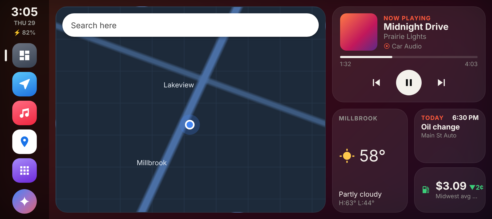
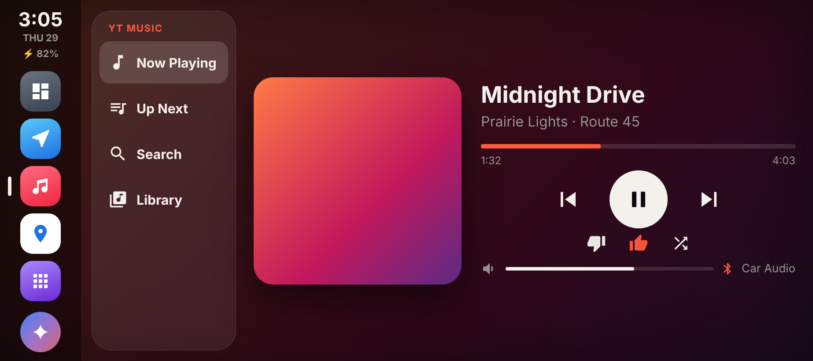
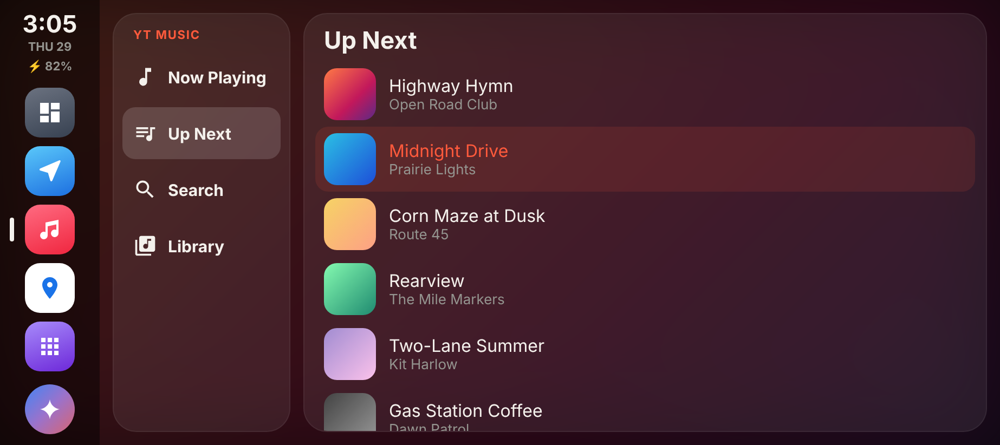
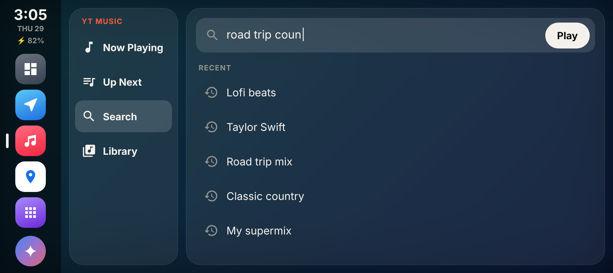
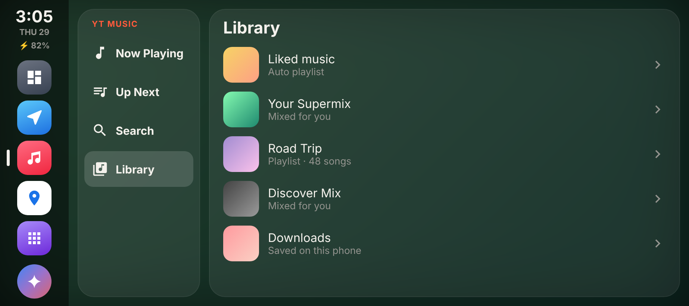
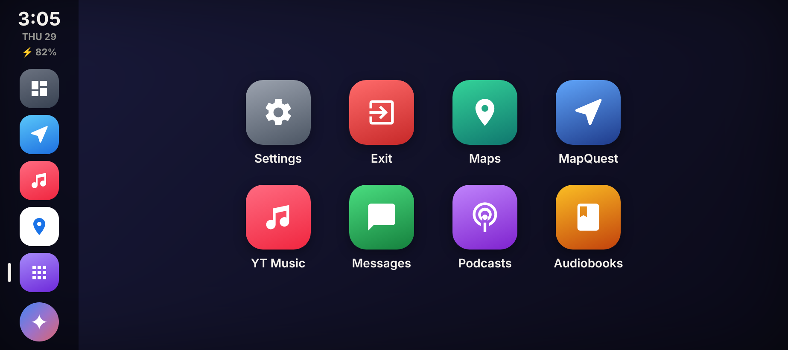

# CarDash

A CarPlay-style dashboard app for Android phones. It puts Google Maps, your music and a few at-a-glance widgets on one landscape screen, with a dock on the side like CarPlay. Made for a Pixel 9, but it works on any phone running **Android 12 or newer**.

## Download

**[Download CarDash.apk](https://github.com/packerd658/cardash/raw/main/CarDash.apk)** (about 170 KB)

See [CHANGELOG.md](CHANGELOG.md) for what's new in each update.

## Features

- **Dashboard**: a live Google Maps view, now playing, and widgets for weather, your next calendar event, battery and local gas prices
- **Maps**: Google Maps inside the app, or open MapQuest with one tap
- **Music**: a YouTube Music screen with Now Playing, Up Next, Search and Library tabs. It also controls whatever app is playing.
- **Gemini button**: opens Google's assistant
- **Apps screen**: shows only your car-friendly (Android Auto) apps, plus Settings and an Exit button
- **Split screen**: run CarDash next to another app, and the dock moves to the outer edge
- **Wallpapers**: album art, your own photo, or gradient presets, with optional blur
- **Weather and gas prices with no account or API key** (Open-Meteo and the U.S. EIA's public data)

## Screenshots

*Design mockups at a Pixel 9's landscape size.*

| | |
| --- | --- |
|  **Now Playing** |  **Up Next** |
|  **Search** |  **Library** |
|  **Apps screen** | |

## Install

1. On your phone, open the **Download CarDash.apk** link above.
2. Open the downloaded file. Android will ask you to allow installs from your browser (or Files app). Allow it, then tap **Install**.
   - Android may warn that the app is from an unknown developer. That's expected: CarDash isn't on the Play Store and is signed with a development key.
3. Open CarDash and allow what it asks for:
   - **Notification access**: lets it show and control the song that's playing. Tap the banner on the dashboard to turn it on.
     If Android says the setting is restricted, go to **Settings → Apps → CarDash → ⋮ (top right) → Allow restricted settings**, then try again.
   - **Location**: for local weather and the map
   - **Calendar**: for the next-event widget (optional)

To update, download the newest APK and install it over the old one. Your settings are kept.

## Privacy

CarDash has no account, ads or tracking. Weather comes from [Open-Meteo](https://open-meteo.com/), and gas prices come from the U.S. Energy Information Administration's public data. Everything else stays on your phone.

## License

MIT. See [LICENSE](LICENSE).
